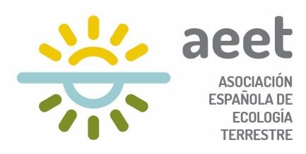

## Investigador principal

**Antonio J. Pérez-Luque**
Instituto de Ciencias Forestales (ICIFOR), INIA-CSIC
[ORCID 0000-0002-1747-0469](https://orcid.org/0000-0002-1747-0469) · [GitHub](https://github.com/ajpelu)

## Colaboraciones

::: {.columns}
::: {.column width="48%"}
**[Teledetección]{.c-tele}**

- Clemens Mosig (Leipzig University)\*
- Rocío Hernández-Clemente (Universidad de Córdoba)
- Pablo J. Zarco-Tejada (IAS-CSIC)

**Aplicación Google Earth Engine**

- J. Martínez-López (Universidad de Granada)
:::

::: {.column width="4%"}
:::

::: {.column width="48%"}
**[Dendrocronología]{.c-dendro}**

- Guillermo Gea-Izquierdo (ICIFOR, INIA-CSIC)
- Darío Martín-Benito (ICIFOR, INIA-CSIC)

**Microbiología y suelos**

- M. Fernández-López (EEZ-CSIC)\*
- A. V. Lasa (EEZ-CSIC)\*
:::
:::

\* Colaboraciones potenciales.

## Transferencia

Los resultados se compartirán con los responsables de la gestión forestal del área de estudio y con la [Red Ibérica de Decaimiento Forestal inducido por el Clima](https://redeciberica.es/) (grupo de trabajo de la AEET). El código estará disponible en repositorios abiertos.

::: {.funding}
{fig-alt="Logotipo de la Asociación Española de Ecología Terrestre"}

Proyecto financiado por la **Asociación Española de Ecología Terrestre (AEET)** — *Ayudas a Proyectos de Investigación AEET en Ecología 2024*.
:::
