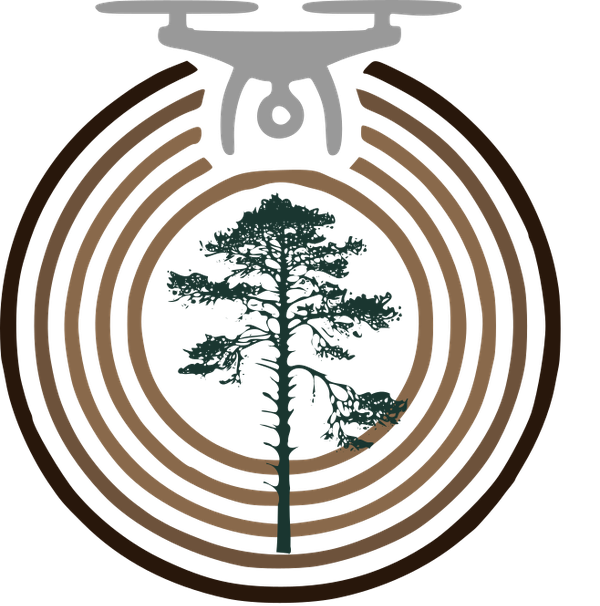
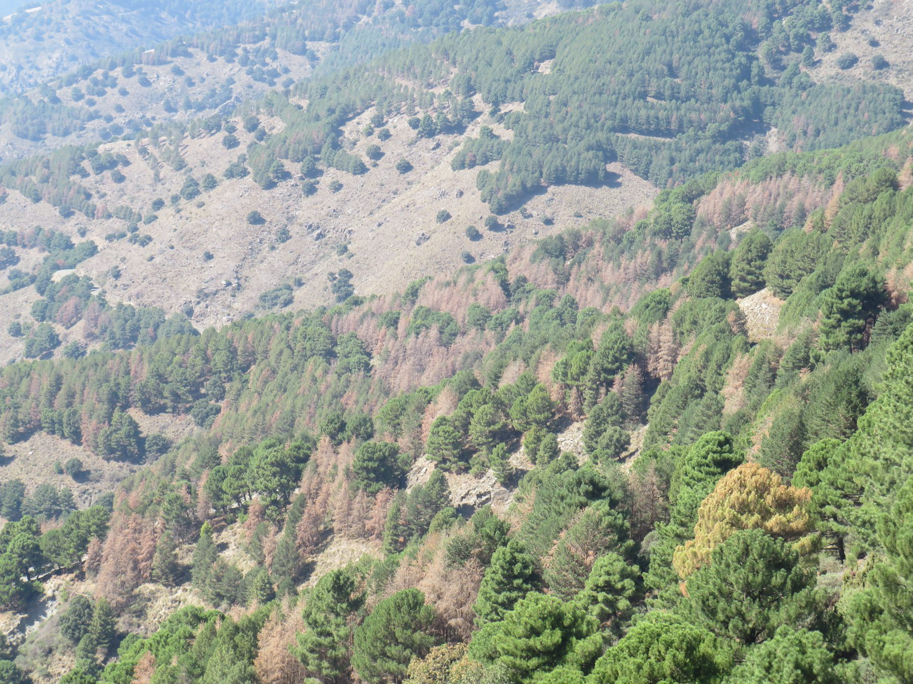
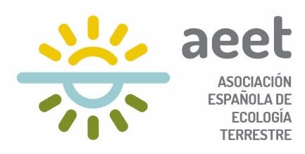

::: {.hero}
{fig-alt="Logotipo de MorTeDen: anillos de crecimiento, un pino y un dron"}

::: {}

MorTeDen

Evaluación multiescalar del decaimiento y la <b class="mtd m">MOR</b>talidad en pinares mediterráneos integrando métodos de <b class="c-tele">TE</b>ledetección y <b class="c-dendro">DEN</b>drocronología

:::
:::

::: {.lead-box}
Desarrollar una herramienta para identificar áreas de [mortalidad forestal]{.hl-mort} mediante [teledetección]{.hl-tele}, para posteriormente analizar en detalle diferencias en productividad primaria y [crecimiento]{.hl-dendro} entre árboles sanos y enfermos.
:::

## El proyecto

En las últimas décadas, la frecuencia de los procesos de decaimiento y mortalidad forestal ha aumentado debido al cambio climático. Estos eventos afectan negativamente a los servicios ecosistémicos de los bosques y requieren una gestión forestal urgente para prevenir y mitigar sus efectos. La mortalidad forestal es un proceso complejo y multifactorial, en el que factores bióticos y abióticos interactúan en el espacio y en el tiempo, lo que dificulta su predicción y comprensión.

**MorTeDen** combina teledetección por satélite, drones y dendrocronología para analizar el patrón de decaimiento y mortalidad en pinares de repoblación del **Parque Natural Sierras de Tejeda, Almijara y Alhama** (Andalucía). El fin último es disponer de una herramienta para detectar puntos calientes de decaimiento y comprender mejor los mecanismos que lo provocan, contribuyendo a su gestión y prevención en un contexto de cambio global.

## Objetivos

::: {.obj-grid}
::: {.obj-card .o1}
[O1]{.obj-tag}

Identificar mediante **teledetección** rodales en decaimiento y rodales en estado sanitario óptimo.
:::

::: {.obj-card .o2}
[O2]{.obj-tag}

Analizar las características **climáticas, topográficas y estructurales** que explican la ocurrencia de decaimiento.
:::

::: {.obj-card .o3}
[O3]{.obj-tag}

Comparar **productividad primaria** (dron) y **crecimiento secundario** (dendrocronología) entre árboles sanos y enfermos.
:::
:::

Más detalle en [Proyecto](proyecto.qmd) y [Metodología](metodologia.qmd). El diseño de muestreo puede explorarse en el [mapa de zonas de muestreo](muestreo.qmd), y los avances se irán publicando en [Resultados preliminares](resultados.qmd).

{fig-alt="Ladera con pinares que muestran copas secas y defoliadas"}

::: {.funding}
{fig-alt="Logotipo de la Asociación Española de Ecología Terrestre"}

Proyecto financiado por la **Asociación Española de Ecología Terrestre (AEET)**. Convocatoria *Ayudas a Proyectos de Investigación AEET en Ecología 2024*, modalidad «Ganando independencia».
:::
