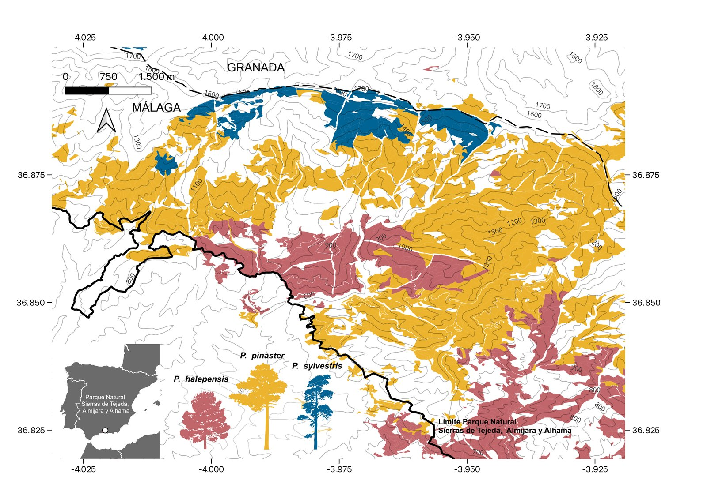
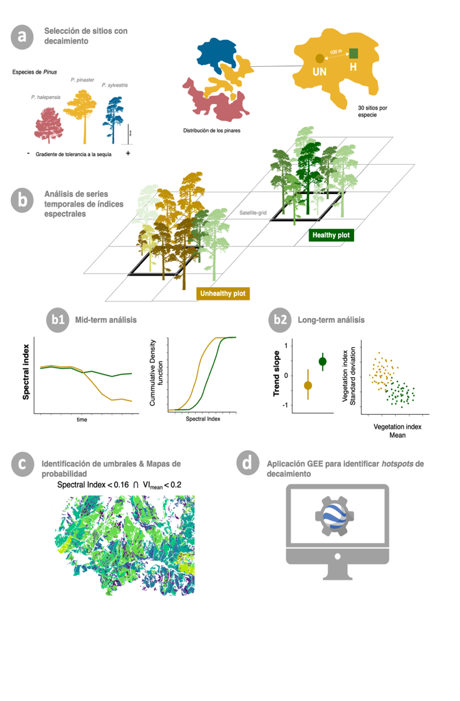
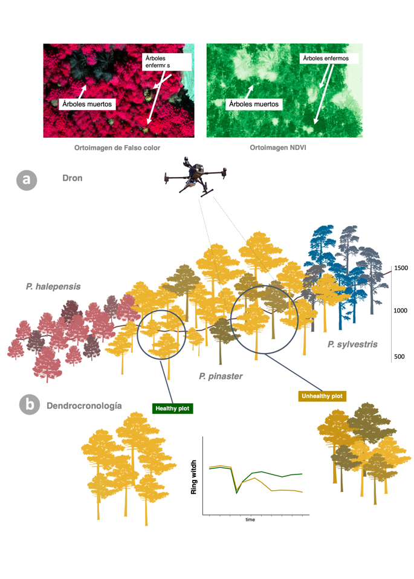
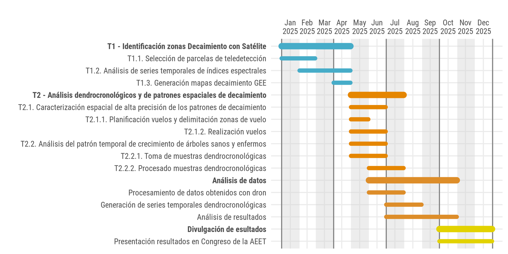

## Zona de estudio

Trabajamos en el **Parque Natural Sierras de Tejeda, Almijara y Alhama** (Málaga–Granada), donde recientemente se han descrito procesos de mortalidad en pinares [@lasa2024]. Los pinares de repoblación de la zona se distribuyen a lo largo de un gradiente altitudinal, con [*P. halepensis*]{.sp .sp-hal} en las cotas bajas, [*P. pinaster*]{.sp .sp-pin} en las intermedias y [*P. sylvestris*]{.sp .sp-syl} en las más altas.

{fig-alt="Mapa del Parque Natural con la distribución de los pinares coloreada por especie"}

Las parcelas concretas pueden consultarse en el [mapa interactivo de zonas de muestreo](muestreo.qmd).

## T1. Identificación de procesos de mortalidad mediante teledetección

::: {.columns}
::: {.column width="58%"}
[T1.1]{.task} **Selección de parcelas.** Con la ayuda de los gestores y Agentes Forestales y de [deadtrees.earth](https://deadtrees.earth), seleccionamos parejas de rodales (30 sitios por especie):

- [UNhealthy]{.badge-un} rodal con decaimiento: > 75 % de cobertura arbórea y > 50 % de árboles sintomáticos.
- [Healthy]{.badge-h} rodal no sintomático, separado al menos 100 m.

[T1.2]{.task} **Series temporales de teledetección.** Construimos series de índices espectrales (NDVI, NBR, CI) [@buras2021] para cada tipo de parcela con productos de distinta resolución (Planet 3.5 m; Sentinel-2 10 m; Landsat 30 m). Con el algoritmo BEAST [@zhao2019] detectamos cambios abruptos [@morenofernandez2021; @mulverhill2023]; comparando funciones de distribución acumulada identificamos umbrales que discriminan sitios *UNhealthy* y *Healthy* [@navarro2019], y comparamos tendencias a largo plazo (Mann-Kendall-Theil-Sen).

[T1.3]{.task} **Mapas de probabilidad de decaimiento.** Combinando los umbrales que mejor discriminan parcelas sanas y enfermas generamos mapas de probabilidad [@candotti2022] y una aplicación en Google Earth Engine [@gorelick2017; @hansen2013] para identificar *hotspots* de decaimiento.
:::

::: {.column width="4%"}
:::

::: {.column width="38%"}
{fig-alt="Esquema de la tarea 1: selección de parcelas, series temporales, umbrales y aplicación GEE"}
:::
:::

## T2. Decaimiento a escala de árbol: drones y dendrocronología

Usando dos parcelas por especie (*Healthy*/*UNhealthy*) analizamos la productividad primaria del dosel con dron y comparamos el crecimiento radial entre árboles sanos y enfermos.

::: {.columns}
::: {.column width="58%"}
[T2.1]{.task} **Caracterización espacial de alta precisión.** Vuelos de dron con sensores multiespectral, RGB y LiDAR para obtener la estructura forestal detallada, identificar árboles individuales y generar ortomosaicos con índices espectrales de 2.5–5 cm.

[T2.2]{.task} **Patrón temporal de crecimiento.** Parcelas de radio variable hasta 20 árboles/parcela. Medimos altura y diámetro normal y extraemos testigos con barrena de Pressler. Los anillos se miden y datan con lupa binocular y mesa LINTAB-TSAP, la datación se verifica con COFECHA [@holmes1983] y las tendencias de crecimiento se estiman siguiendo procedimientos dendrocronológicos estándar [@cook1990].
:::

::: {.column width="4%"}
:::

::: {.column width="38%"}
{fig-alt="Esquema de la tarea 2: dron sobre pinares sanos y enfermos y series de anchura de anillo"}
:::
:::

## Cronograma

{fig-alt="Diagrama de Gantt con las tareas del proyecto a lo largo de 2025"}

## Referencias

::: {#refs}
:::
