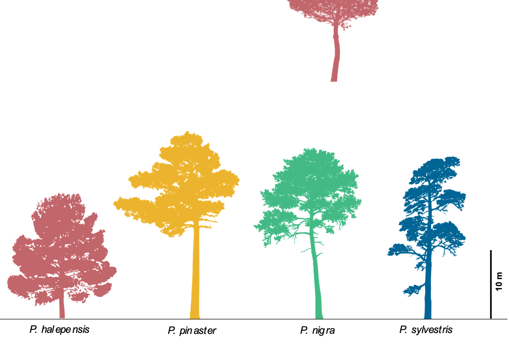

## Justificación

En las últimas décadas se ha observado una intensificación de los procesos de decaimiento y mortalidad forestal en todo el mundo, forzados por el cambio global [@allen2010; @hammond2022; @hartmann2022]. En la Península Ibérica se han registrado episodios de mortalidad asociados principalmente a sequías y veranos calurosos, tanto en bosques de coníferas —especialmente del género *Pinus*— como de frondosas, incluido el género *Quercus* [@gea2019; @gea2021holm; @gea2021jecol; @martinezvilalta2002; @penuelas2001]. Estos episodios tienen un gran impacto sobre los servicios ecosistémicos que proveen las masas forestales.

El cambio climático está exacerbando la intensidad, frecuencia y duración de estos procesos, provocando eventos de mortalidad a gran escala [@hartmann2022]. Es necesario adaptar la gestión forestal, tanto en los bosques que ya muestran decaimiento [@petitcailleux2021] como en los que aún no lo manifiestan, por ejemplo modificando su estructura o favoreciendo especies más tolerantes a la sequía.

A pesar de numerosos esfuerzos de investigación, los mecanismos que provocan esta mortalidad acelerada aún no se comprenden completamente [@anderegg2015], ya que es un proceso multifactorial en el que intervienen factores bióticos y abióticos interrelacionados [@lloret2012; @menezes2019]. Bajo estrés, los árboles sufren limitaciones en sus dinámicas de carbono y agua que pueden desembocar en fallo hidráulico y déficit de carbono [@choat2018]. Además, es difícil predecir dónde y cuándo se producirán estos procesos [@anderegg2019; @cailleret2019; @camarero2015; @morenofernandez2021]: las zonas afectadas presentan patrones espaciales complejos y difusos, condicionados también por el suelo o la microtopografía [@ferriz2021].

Por ello se requieren **enfoques multidisciplinares** a diferentes y complementarias escalas espacio-temporales [@hartmann2018]:

- La [teledetección]{.hl-tele} permite cuantificar la frecuencia y el alcance de las perturbaciones a distintas escalas [@buras2021; @mcdowell2015; @wulder2006] y es esencial para cartografiar el decaimiento a gran escala [@huang2019; @mantas2022; @navarro2019].
- Los análisis [dendroecológicos]{.hl-dendro} de crecimiento retrospectivo ofrecen una oportunidad única para detectar el comienzo y desarrollo de los procesos de decaimiento [@cailleret2017].

## Hipótesis

H1
: Las imágenes de satélite de resolución moderada son adecuadas para identificar puntos calientes de declive forestal a escala regional.

H2
: En la zona de estudio (repoblaciones de pino, generalmente de alta densidad), las masas con mayor estrés hídrico, estrés biótico y/o alta densidad de pies tienen mayor probabilidad de mostrar tasas de declive elevadas.

## Objetivos

El proyecto persigue un doble fin: **(i)** desarrollar una herramienta que identifique masas forestales con alta probabilidad de mortalidad a partir de información de satélite, y **(ii)** analizar los *drivers* ecológicos que gobiernan la probabilidad de que una masa experimente decaimiento.

### O1. Identificación de procesos de mortalidad forestal utilizando [teledetección]{.c-tele}

¿Podemos identificar rodales forestales en decaimiento utilizando teledetección? Desarrollaremos una herramienta para detectar *hotspots* de decaimiento en pinares mediterráneos, comparando distintos sensores para optimizar la escala espacio-temporal de las imágenes.

### O2. Variables explicativas de la ocurrencia de decaimiento

¿Tienen las áreas en decaimiento identificadas en O1 características topográficas, climáticas o de sitio que determinan esos eventos? ¿Qué factores —y en qué medida— explican los cambios observados en las tendencias de los índices espectrales?

### O3. Árboles sanos y enfermos: productividad primaria ([teledetección de detalle]{.c-tele}) y crecimiento secundario ([dendrocronología]{.c-dendro})

¿Existen patrones espaciales de decaimiento identificables con índices espectrales de alta resolución? ¿Difieren las tendencias temporales de crecimiento secundario entre árboles sanos y enfermos? Este objetivo se aborda a escala de árbol en una submuestra de parcelas.

## Especies objetivo

Trabajamos con pinos que siguen un gradiente decreciente de tolerancia a la sequía y que son representativos de las repoblaciones forestales en la Península Ibérica [@vadell2019]: [*Pinus halepensis*]{.sp .sp-hal} Mill., [*P. pinaster*]{.sp .sp-pin} Ait. y [*P. sylvestris*]{.sp .sp-syl} L.

{fig-alt="Siluetas de cuatro especies de pino coloreadas: P. halepensis, P. pinaster, P. nigra y P. sylvestris"}

## Referencias

::: {#refs}
:::
