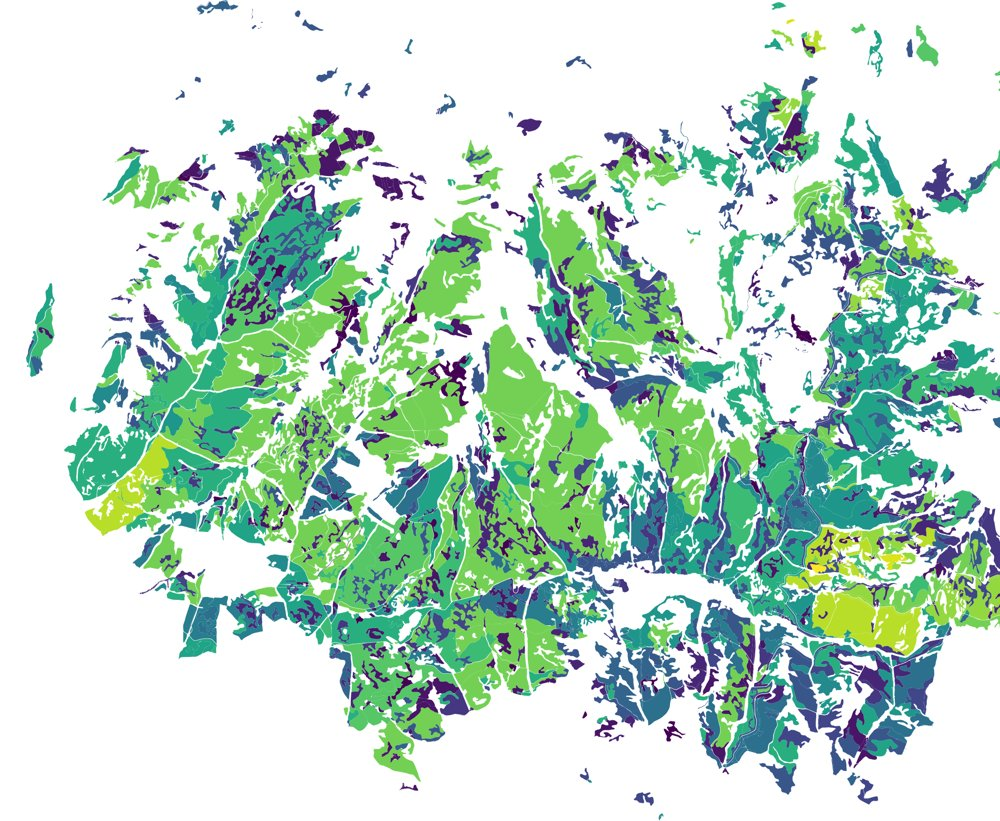
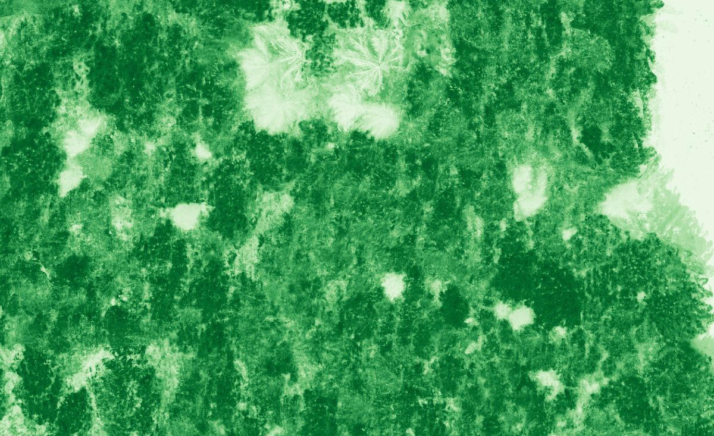

```{r}
#| label: setup
source("R/setup.R")

f_tareas  <- "data/estado_tareas.csv"
f_series  <- "data/series_indices.csv"
f_anillos <- "data/crecimiento_anillos.csv"

hay_series  <- file.exists(f_series)
hay_anillos <- file.exists(f_anillos)

pendiente <- function(txt) {
  cat("::: {.callout-note appearance=\"simple\"}\n", txt, "\n:::\n", sep = "")
}
```

::: {.callout-important appearance="simple"}
Los resultados de esta página son **preliminares** y pueden cambiar a medida que avance el análisis.
:::

## Estado de las tareas

```{r}
#| label: tareas
estado_col <- c("Completada" = "#006300", "En curso" = "#ECB42E", "Pendiente" = "#999999")

read_csv(f_tareas, show_col_types = FALSE) |>
  mutate(Estado = sprintf(
    "<span style='background:%s;color:#fff;padding:.1em .5em;border-radius:2px;font-size:.85em'>%s</span>",
    estado_col[estado], estado)) |>
  select(tarea, descripcion, Estado) |>
  knitr::kable(escape = FALSE, col.names = c("Tarea", "Descripción", "Estado"))
```

## O1. Identificación de decaimiento mediante teledetección

### Series temporales de índices espectrales

```{r}
#| label: series-pendiente
#| results: asis
#| eval: !expr '!hay_series'
pendiente("Las series temporales (NDVI, NBR, CI) de parcelas *Healthy* y *UNhealthy* se mostrarán aquí cuando `data/series_indices.csv` esté disponible.")
```

```{r}
#| label: fig-series
#| eval: !expr hay_series
#| fig-cap: "Evolución de los índices espectrales (media ± error estándar) en parcelas sanas y con decaimiento."
#| fig-width: 9
#| fig-height: 6
series <- read_csv(f_series, show_col_types = FALSE) |>
  left_join(leer_sitios() |> select(id_sitio, especie, estado), by = "id_sitio")

series |>
  group_by(especie, estado, indice, fecha) |>
  summarise(m = mean(valor, na.rm = TRUE),
            se = sd(valor, na.rm = TRUE) / sqrt(sum(!is.na(valor))), .groups = "drop") |>
  ggplot(aes(fecha, m, colour = estado, fill = estado)) +
  geom_ribbon(aes(ymin = m - se, ymax = m + se), alpha = .2, colour = NA) +
  geom_line(linewidth = .7) +
  facet_grid(indice ~ especie, scales = "free_y") +
  scale_colour_manual(values = col_estado) +
  scale_fill_manual(values = col_estado) +
  labs(x = NULL, y = "Valor del índice") +
  theme_mtd()
```

### Hacia los mapas de probabilidad de decaimiento

::: {.columns}
::: {.column width="62%"}
{fig-alt="Mapa con probabilidades de decaimiento en tonos verde-azul-amarillo"}
:::

::: {.column width="6%"}
:::

::: {.column width="32%"}
Los umbrales que mejor discriminen entre parcelas sanas y enfermas se combinarán para generar mapas de probabilidad y una **aplicación en Google Earth Engine** para identificar *hotspots* de decaimiento.

{width="110px" fig-alt="Icono de Google Earth Engine"}
:::
:::

## O3. Árboles sanos y enfermos a escala de árbol

### Caracterización con dron

::: {layout-ncol="2"}
{fig-alt="Ortoimagen de dron en falso color con árboles enfermos y muertos señalados"}

{fig-alt="Ortoimagen NDVI de dron con árboles enfermos y muertos señalados"}
:::

Las ortoimágenes multiespectrales permiten distinguir a escala de copa árboles **enfermos** y **muertos**, base para analizar los patrones espaciales del decaimiento y la productividad primaria del dosel.

### Crecimiento radial (dendrocronología)

```{r}
#| label: anillos-pendiente
#| results: asis
#| eval: !expr '!hay_anillos'
pendiente("Las series de crecimiento de árboles sanos y enfermos se mostrarán aquí cuando `data/crecimiento_anillos.csv` esté disponible.")
```

```{r}
#| label: fig-anillos
#| eval: !expr hay_anillos
#| fig-cap: "Crecimiento radial medio (± error estándar) de árboles en parcelas sanas y con decaimiento."
#| fig-width: 9
#| fig-height: 4
anillos <- read_csv(f_anillos, show_col_types = FALSE) |>
  left_join(leer_sitios() |> select(id_sitio, especie, estado), by = "id_sitio")

anillos |>
  group_by(especie, estado, year) |>
  summarise(m = mean(rw, na.rm = TRUE),
            se = sd(rw, na.rm = TRUE) / sqrt(sum(!is.na(rw))),
            n = sum(!is.na(rw)), .groups = "drop") |>
  filter(n >= 5) |>
  ggplot(aes(year, m, colour = estado, fill = estado)) +
  geom_ribbon(aes(ymin = m - se, ymax = m + se), alpha = .2, colour = NA) +
  geom_line(linewidth = .7) +
  facet_wrap(~especie, nrow = 1) +
  scale_colour_manual(values = col_estado) +
  scale_fill_manual(values = col_estado) +
  labs(x = NULL, y = "Anchura de anillo (mm)") +
  theme_mtd()
```

## Formato de los datos

Para que esta página se actualice automáticamente basta con añadir los ficheros a la carpeta `data/` y volver a renderizar:

| Fichero | Columnas |
|---|---|
| `estado_tareas.csv` | `tarea`, `descripcion`, `estado` (Completada / En curso / Pendiente) |
| `series_indices.csv` | `id_sitio`, `fecha` (AAAA-MM-DD), `indice` (NDVI, NBR, CI…), `valor` |
| `crecimiento_anillos.csv` | `id_sitio`, `id_arbol`, `year`, `rw` (mm) |

: {tbl-colwidths="[30,70]"}

`id_sitio` debe coincidir con el de [`sitios_muestreo.csv`](muestreo.qmd).
